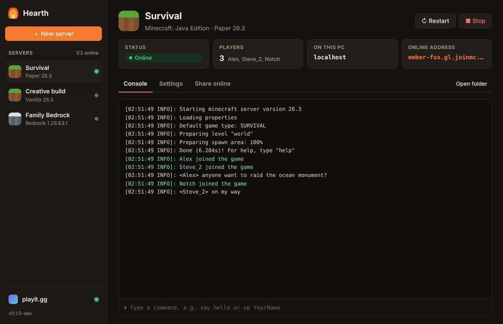
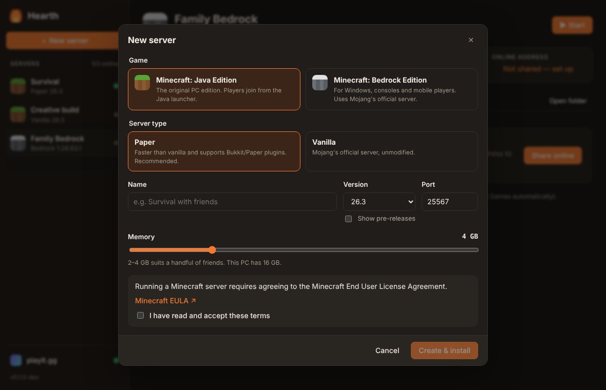
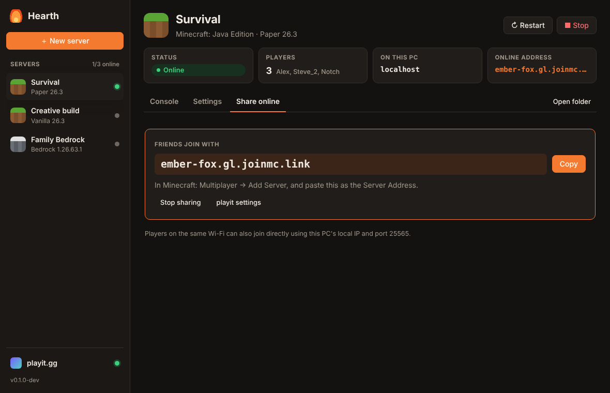

# Hearth

**Host game servers on your own PC.** Pick a game, click create, and Hearth downloads and
runs everything it needs, including the right Java version. One click shares the server online
through [playit.gg](https://playit.gg), so friends can join without router setup or port forwarding.



## Features

- **Minecraft: Java Edition**: Paper (recommended), Vanilla, or modded with **Fabric, NeoForge or Forge**
- **Modpacks**: import a Modrinth `.mrpack` or a pack's server pack `.zip`, and manage mods/plugins from the **Mods** tab
- **Minecraft: Bedrock Edition**: Mojang's official Bedrock Dedicated Server, with one-click updates that keep your worlds
- **No Java install needed**: Hearth downloads the right Eclipse Temurin runtime for each Minecraft version
- **Live console**: colored logs, command box with history, players online at a glance
- **Players tab**: operator on/off, whitelist, ban/unban, kick and game mode per player, whether the server is running or not
- **Settings without file editing**: MOTD, game mode, difficulty, whitelist, port, memory and every raw `server.properties` key
- **Share online**: link playit.gg once, then *Share online* creates a tunnel and shows the address to send to friends
- **Safe by default**: verified downloads, graceful shutdown that saves worlds, and servers stop if Hearth is closed or crashes

| New server | Share online |
|---|---|
|  |  |

## Install

Download the latest installer from the [Releases](../../releases) page and run it. Hearth installs
per user and needs no administrator rights.

> The installer is not code-signed yet, so Windows SmartScreen may warn on first run.
> Choose *More info → Run anyway*.

### Bedrock tip

If Minecraft Bedrock on the **same PC** can't see your server, Windows may be blocking the game
from reaching `localhost`. Run this once in an administrator terminal:

```bash
CheckNetIsolation.exe LoopbackExempt -a -n="Microsoft.MinecraftUWP_8wekyb3d8bbwe"
```

## Where things live

Everything is under `%APPDATA%\app.hearth.desktop\`:

```
instances\<server-id>\instance.json   Hearth's record of the server
instances\<server-id>\server\         the actual server folder (worlds, configs, plugins)
runtimes\java-<N>\                    shared Java runtimes
playit\                               playit.gg agent key and logs
```

Use **Open folder** on a server to get to its files. Mods and Paper plugins can be added from the **Mods** / **Plugins** tab.

## Development

Requirements: Rust (stable), Node.js 22+. On Linux, the [Tauri system libraries](https://v2.tauri.app/start/prerequisites/).

```bash
npm install
```

```bash
npm run tauri dev
```

UI-only development in a normal browser, with a simulated backend:

```bash
npm run dev
```

Tests:

```bash
cargo test --workspace
```

Live tests download real servers (~150 MB) and start one:

```bash
cargo test -p hearth-core --test live -- --ignored --nocapture
```

Build the Windows installer (on Windows):

```bash
npx tauri build
```

Pushing a `v*` tag runs the release workflow, which builds the installers and attaches them to a draft GitHub release.

### Layout

| Path | What |
|---|---|
| `crates/hearth-core` | All logic, no UI: game providers, installer, process supervisor, playit integration |
| `src-tauri` | Desktop shell: Tauri commands that call the core, and core events forwarded to the UI |
| `ui` | React + TypeScript interface |
| `docs/superpowers/specs` | Design document |

### Adding a game

Implement `GameProvider` (`crates/hearth-core/src/games/mod.rs`) in a new file: version list,
install, launch command, log parsing for "ready" and player join/leave. Then register it in
`Registry::builtin`. The UI reads the game catalog from the core, so a new game shows up in the
*New server* dialog automatically.

## License

MIT. Minecraft is a trademark of Mojang Synergies AB. Hearth is not affiliated with Mojang,
Microsoft or playit.gg. Server software is downloaded from its official sources, and you
accept its license when creating a server.
